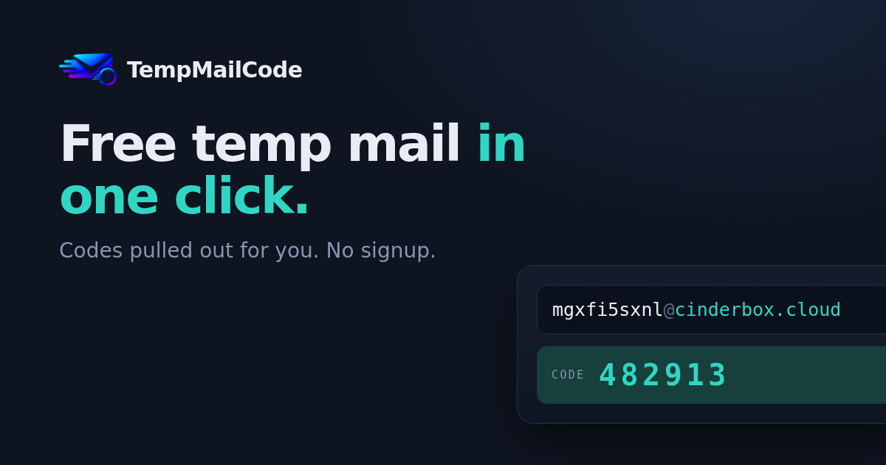

<div align="center">
  
  <h1>TempMailCode</h1>
  <p><strong>Free Disposable Temporary Email Generator for OTP & Verification Codes</strong></p>

  <p>
    <a href="https://tempmailcode.com/"></a>
    <a href="https://tempmailcode.com/api"></a>
    <a href="https://tempmailcode.com/terms"></a>
  </p>

  <p>
    <a href="https://tempmailcode.com/"><b>Open Live Inbox →</b></a> ·
    <a href="https://tempmailcode.com/api"><b>REST API Specs</b></a> ·
    <a href="https://tempmailcode.com/guide"><b>Architecture Guide</b></a>
  </p>
</div>

---

## 📸 Product Preview

<div align="center">
  
  <p><em>TempMailCode live web interface automatically isolating a 6-digit verification passcode ready for one-click copying.</em></p>
</div>

---

## 📖 About TempMailCode

When registering for forums, software trials, WiFi portals, or mobile applications, services routinely require an email address to verify your identity. Providing your personal email exposes you to tracking pixels, data breaches, and endless promotional newsletters.

**[TempMailCode](https://tempmailcode.com/)** provides an anonymous, throwaway email address the moment the page loads. 

Unlike conventional temporary mail providers that act as basic webmail viewers and force you to open marketing-heavy HTML emails, **TempMailCode parses the incoming message and surfaces the 4 to 8 digit verification code (OTP) directly on the inbox table with a single-click copy button.**

---

## ⚡ Core Features

* **Instant Generation:** No signup, no passwords, and no account creation. A random address on an active domain is generated immediately.
* **Smart OTP Extraction:** Automatic regex heuristics isolate one-time passcodes, activation PINs, and security tokens from incoming emails.
* **Privacy by Design:** Remote tracking pixels and images are blocked by default to prevent senders from knowing your address is active.
* **In-Memory Retention (TTL):** Messages reside strictly in volatile server RAM and are automatically deleted after 60 minutes.
* **Receive-Only Protection:** The catch-all SMTP server receives mail but never sends any, eliminating outbound spam abuse.
* **Catch-All Domain Rotation:** Subdomain wildcards (`*.example.com`) and continuous domain rotation ensure bypass of naive disposable email blocklists.

---

## 🛠️ Automated Testing & Developer REST API

For QA engineers and developers automating end-to-end user onboarding in **Playwright**, **Cypress**, or **Selenium**, TempMailCode provides a high-speed JSON REST API.

* **Documentation & Endpoints:** [https://tempmailcode.com/api](https://tempmailcode.com/api)
* **OpenAPI 3.1 Specification:** `https://tempmailcode.com/api/v1/openapi.json`

### Automated cURL Example
```bash
# 1. Claim a fresh temporary address
curl -X POST https://tempmailcode.com/api/v1/addresses \
  -H "Authorization: Bearer $API_KEY" \
  -H "Content-Type: application/json" -d '{}'

# 2. Poll incoming messages (the OTP code is returned on messages[0].otp directly)
curl -H "Authorization: Bearer $API_KEY" \
  "https://tempmailcode.com/api/v1/addresses/YOUR_ADDRESS/messages"

# 3. Clean up and release the mailbox
curl -X DELETE -H "Authorization: Bearer $API_KEY" \
  "https://tempmailcode.com/api/v1/addresses/YOUR_ADDRESS"
```

---

## 📚 Official Resources & Backlinks

* **Live Web App:** [https://tempmailcode.com/](https://tempmailcode.com/)
* **Developer API Documentation:** [https://tempmailcode.com/api](https://tempmailcode.com/api)
* **Architectural Comparison Guide:** [https://tempmailcode.com/guide](https://tempmailcode.com/guide)
* **Contact & Abuse Reporting:** [https://tempmailcode.com/contact](https://tempmailcode.com/contact)
* **Privacy Policy:** [https://tempmailcode.com/privacy](https://tempmailcode.com/privacy)
* **Terms of Use:** [https://tempmailcode.com/terms](https://tempmailcode.com/terms)

---

## ⚖️ License
The documentation and client showcase is distributed under the MIT License. The live email processing service is provided "as-is" under the [TempMailCode Terms of Service](https://tempmailcode.com/terms).
